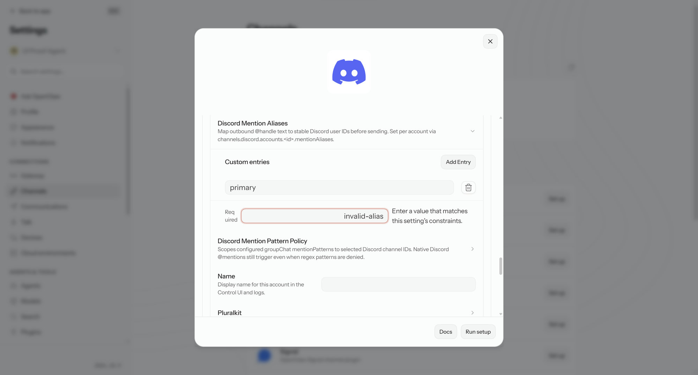

# PR #182085 — invalid channel drafts block Save

- Integrated head: `32e6b9e0621e700aba2935aa474b07e6c874535b`.
- Integration base: `b01ec056ade05bad61475ba7af3305cabb9740af`.
- Route: `/settings/channels`, Discord details, production build on a real isolated Gateway. Discord was disabled and had no bot credential; no real service was contacted.

## Observed behavior

1. Set the existing `mentionAliases.primary` text field from synthetic `111` to `invalid-alias`. The invalid text stays visible and focused, `aria-invalid=true`, an inline constraint error appears, Save is disabled, Reload remains enabled. A disabled Save click does not persist the invalid draft; the file still contains `111`.
2. Correct it to `555`. The error clears and the Gateway-acknowledged persisted file contains `555`. **Valid edits auto-persisted on this current runtime; by the subsequent explicit Save attempt, the button was disabled because no dirty config remained. This is not an assertion that an enabled Save request was exercised.**
3. Set `maxLinesPerMessage` to invalid `0`: text remains focused/visible, Save is disabled, Reload is enabled. Invoke Reload while invalid. It remains usable but does not discard the local invalid draft when the backing numeric value is unchanged. Correct to `21`; the persisted file contains `21`.

## Checks

- Pinned-head `view.config.browser.test.tsx`: 1 Chromium regression test passed (another dirty field cannot be saved while a channel scalar draft is invalid).
- Exact-head production Vite build passed.
- Independent read-only diff reviews found no confirmed introduced correctness findings.

No claim is made that all repository tests or newly triggered CI have completed. JSON-invalid and additional rejection-path coverage remain useful optional extensions; only the concrete cases above were exercised through the shipped route.

## Exact-head review and bounded followthrough

ClawSweeper reviewed32e6b9e0621e700aba2935aa474b07e6c874535b on October31,2026: findings0, exact-headCI green, but explicit enabledSave proof remains required. Review: https://github.com/openclaw/openclaw/pull/182085#issuecomment-6378559101

Two bounded, native-interaction attempts did not satisfy the prerequisites and are NOT passing evidence. The separated nativeEnter diagnostic confirmed Name/scalar/Save in the real novalidate form and viewport, but its submission snapshot took1505ms, beyond the unchanged800ms autosave debounce. The numeric scalar read1(valid), not requested0; one config.set was already sent. The runner stopped before the corrected submission. This does not isolate invalid explicitSave and establishes no introduced product defect. No claim that the patch disables normal autosave. Fresh isolated fixtures exited cleanly and their listener absence was verified. Original screenshot limitations above remain unchanged. No corrective source change or new merge/rereview request is justified by these unsuccessful proof attempts.

## Enabled explicit submission — October31,2026,09:09UTC

The missing path now passed on the pinned production /settings/channels page served by a fresh isolated real Gateway. Native Playwright input/keyboard actions only; no source modification, fake event/timer, handler replacement, app-state injection or network interception. The original disabled-Save screenshots above are still not evidence of this new submission.

1. Open Discord details, Advanced Settings and Discord Mention Aliases before the timed edits. Stage invalid string scalar Primary=not-numeric. Unlike numeric0, this stays invalid on blur.
2. Change the separate Name field to Native Enter Proof, making shared configuration dirty and Save enabled. Press native Enter from the already-focused Name input. The actual novalidate form invokes explicit validation: invalid alias remains not-numeric, native validity is false (customError=true), aria-invalid=true and focus moves to the alias. At the immediate666ms snapshot, Save remains enabled and zero config.set requests have occurred. Each predicate is recorded separately.
3. From that now-focused invalid alias, fill valid555 and press native Enter without a refocus/scroll chain. A single config.set is sent391ms after the corrected-edit sequence began, well before the unchanged800ms debounce measured conservatively from before the native fill. Its matching successful Gateway acknowledgement arrives644ms after sequence start; a post-write config.get corroborates the explicit-save path. No previous/in-flight config.set exists. Readback from the isolated persisted configuration confirms Name and Primary555.

[Complete timestamped redacted trace and separated predicates](logs/channel-explicit-native-save-20261031.json). The historical JSON field named scalarValue means the string-valued Primary alias here. Native form submission exercises the same submit boundary as the enabled Save button; this is not a pointer-click recording. Existing source shows explicit admission cancels the pending autosave timer; both paths use config.set, so RPC success alone was not used as attribution.

All invalid and corrected predicates passed; fixture exited gracefully and its listener absence was verified. Earlier unsuccessful numeric and935ms text attempts remain excluded from passing evidence. No product defect, UI-owner approval or merge is claimed. A new exact-head ClawSweeper review must assess this proof.

## Latest exact-head review acceptance

October31,2026 09:16:05 UTC: [ClawSweeper revision3](https://github.com/openclaw/openclaw/pull/182085#issuecomment-6378559101) accepted the shipped-route proof, reported0 findings, listed Before merge: None, and marked PR182085 ready for maintainer review. The machine marker remains needs-human with hold=not_opted_in; it is not a proof hold, maintainer approval, auto-merge opt-in or merge. [Recorded exact-head outcomes](logs/exact-head-review-accepted-20261031.json).
