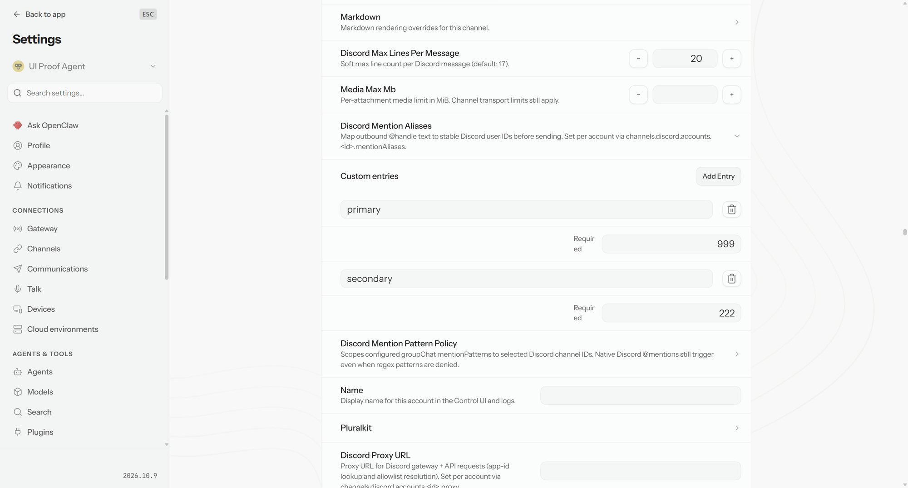

# PR #182063 — collection drafts survive sibling edits

- Locally integrated head: `e1382fde346f345695d70ff0eff6199b3b91d88f`.
- Integration base: `b01ec056ade05bad61475ba7af3305cabb9740af`.
- Route: `/settings/advanced`, Discord mention-alias map, exact-head production Vite build served by a real isolated Gateway. No Discord connection was enabled.

## Observed behavior

1. Existing alias: `primary: "111"`. Open Add Entry and type pending `secondary: "222"`.
2. Edit the existing primary value to `333`, then `444`. After each successive edit, the pending key and value remain unchanged in the mounted entry editor.
3. Commit the pending addition. The Gateway-acknowledged persisted file contains `{primary:"444", secondary:"222"}`, and pending-entry controls close.
4. Open a new pending entry `unfinished: "777"`. In a **second real browser owner** on the same isolated Gateway, replace the primary value with `999`. The original mounted map receives the acknowledged external replacement, shows `{primary:"999", secondary:"222"}`, and the unfinished draft inputs disappear. The persisted file matches; `unfinished` was not written. No navigation/remount or app-state injection was used to manufacture the reset.

## Checks and limits

- Exact-head production Vite build passed.
- Independent static reviewers found no confirmed introduced correctness findings.
- The earlier pre-assertion startup blocker is now diagnosed and browser regression verified; see below. Code refresh remains local and unpushed pending canonical UI types. Remote stays f663fb18bd149f1825570c934f747c9d80b12587.
- Rejected child-patch coverage is still a useful extension and was not exercised by the shipped-route sequence above.

## Verified browser followthrough — October 31, 2026

Runtime config-import traces stop at ui/src/test-helpers/playwright-chromium.ts:66: spawnSync(chromiumExecutablePath, ["--version"], {stdio:"ignore"}) has no timeout. This Windows Chromium version subprocess prevents config evaluation from reaching assertions. Native Vitest import completes. Import-only controls reproduce the stall on base and candidate; the supported executable override set to the SAME actual pinned Chromium path completes both imports. The actual held archive with Vitest5.0.5/Vite8.3.5 reaches the identical blocked call. A separate real Playwright launch creates and reads a Chromium page. Independent static audit identifies the same owner.

No source, assertion, browser version or test gate was bypassed. PLAYWRIGHT_CHROMIUM_EXECUTABLE_PATH selects the actual installed executable via the existing supported path. The complete assertion matrix uses Node24.19.0, Vitest5.0.5, Vite8.3.5, Playwright1.64.1 and the same pinned Chromium for both revisions, with baseline-owned workspace sources.

- Minimal DOM assertion: base PASS, candidate PASS.
- New regression: base3FAIL at expected lost pending key (undefined instead of backup); candidate3PASS.
- Broader collection/config coverage:9files66tests PASS. Repeated with physically owned frozen/offline dependencies; downloaded0, install scripts disabled.
- Two candidate file SHA256 values match the committed original worktree exactly.
- Focused lint:0errors,1pre-existing reactivity warning on unchanged row code. Formatting:PASS.
- Canonical UI typecheck remains a separate publication gate. A short initial budget interrupted an actively compiling native TypeScript process, not browser startup. Its retained private lock was preserved after verifying the owner AND associated descendants stopped; canonical types now run with an adequate bounded deadline. NO typecheck pass, code push or new hostedCI pass is claimed in this evidence revision.

[Controlled matrix](logs/map-controlled-results-20261031.json) · [Import controls](logs/map-startup-controls-20261031.json) · [Minimal test source](logs/map-minimal-test-source-20261031.txt) · [Base red](logs/map-base-regression-20261031.log) · [Candidate green](logs/map-head-regression-20261031.log) · [66-test log](logs/map-head-adjacent-20261031.log). Private paths/tempnamespaces redacted.
