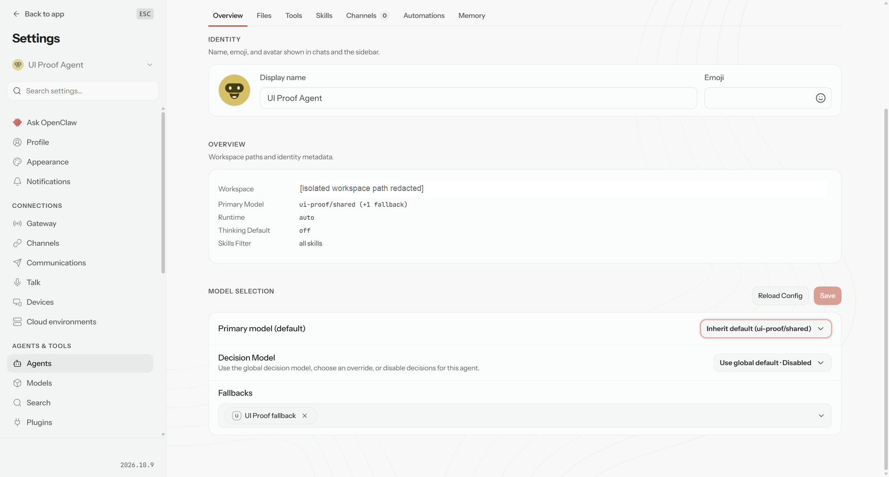
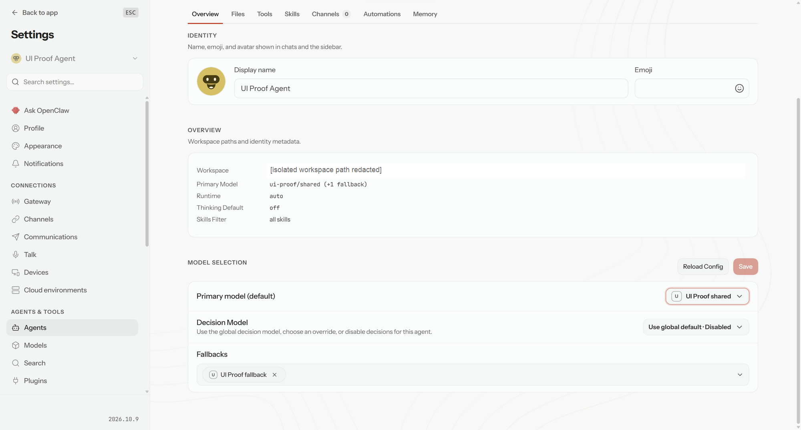

# PR #182678 — default-agent model inheritance

- Integrated head: `0b3147f745860331de37156be6143db57335c7f6`.
- Comparison base: `b01ec056ade05bad61475ba7af3305cabb9740af`.
- Route: `/settings/agents/main`, served from the production Vite build by a real isolated Gateway with synthetic models and config.

## Observed behavior

1. Exact-base route: clear the authored override. The summary resolves to `ui-proof/shared (+1 fallback)`, but the picker misleadingly selects `UI Proof shared`.
2. Integrated route: choose inheritance. The picker says `Inherit default (ui-proof/shared)` and the same effective-model summary remains. The persisted main-agent model contains only `fallbacks: ["ui-proof/fallback"]`; shared defaults are unchanged.
3. Explicitly select `UI Proof shared`. The picker now displays the explicit model, and the persisted main-agent model again includes `primary: "ui-proof/shared"`, preserving fallbacks.
4. Steps 2–3 were repeated in a fresh connected fixture for the accompanying redacted screenshots. Only the workspace path is masked. No app state or RPC response was replaced.

## Checks

- `panels-overview.browser.test.ts`: 7 Chromium tests passed, including default and non-default agents.
- `view.test.tsx`: 25 unit tests passed on the integrated head.
- Production runtime build (`scripts/build-all.mts qaRuntime`): exit 0.
- Exact source base/head built using the same installed Node 24.19 / pnpm 12.15 toolchain and deterministic build environment. Base CSS sidecars were normalized with the candidate canonical compressor; unrelated Windows-incompatible archived fixture paths were excluded, not UI source.
- `scripts/check-control-ui-performance.mts --dist <candidate-dist> --base-dist <base-dist> --json`: exit 0, no violations. Startup gzip: 88,692 → 88,690 bytes (-2). Chat boot gzip: 1,265,692 → 1,265,800 bytes (+108), within the current gate. CSS growth: zero.

## Explicit limitations / external gate

This local refreshed comparison does **not** causally explain the historical +293-byte failure on the old head, and it is not a claim that newly triggered CI is green. Real-route proof used the default main agent; non-default coverage is in the passing browser tests. The UI-owner decision about catalog restriction/retirement and default-agent selection presentation remains unresolved and must not be treated as approved. No merge is requested by this evidence.

## Exact-head review followthrough

ClawSweeper reviewed 0b3147f745860331de37156be6143db57335c7f6 on October31,2026: findings0, shipped-route proof sufficient, exact-head greenCI accepted. Sole remaining merge blocker: UI-owner presentation decision, NOT approved. Review: https://github.com/openclaw/openclaw/pull/182678#issuecomment-6386227135
